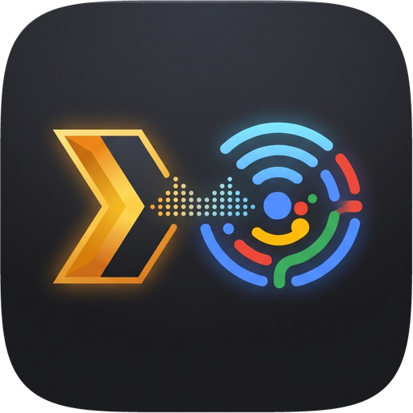
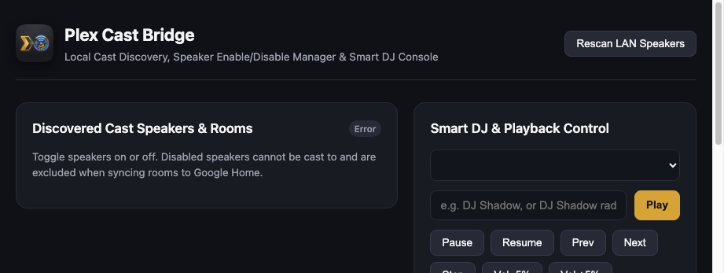

<p align="center">
  
</p>

<h1 align="center">Plex Cast Bridge</h1>

<p align="center"><strong>Your music. Your speakers. No Home Assistant required.</strong></p>

<p align="center">
  <a href="https://github.com/andrewtryder/plex-cast-bridge/actions/workflows/ci.yml"></a>
  <a href="LICENSE"></a>
  <a href="https://github.com/andrewtryder/plex-cast-bridge/pkgs/container/plex-cast-bridge"></a>
</p>

Ever wanted to stream music from your Plex Music Library right to your Google Home / Nest Speaker or Display but without needing to setup HomeAssistant? This is your answer.

**Plex Cast Bridge** is a free, open-source app you run on your own home network. Connect your Plex music library, choose a speaker, and play your music from a simple web dashboard on your phone, tablet, or computer.

You don't need Home Assistant, a separate music streaming subscription, or a Google Cloud project for dashboard playback.

[Get started](#quick-start-docker--portainer) · [Google Home voice control](#google-home-voice-control-optional) · [Installation guide](docs/install-docker.md)



## What can I do with it?

- **Play your own music** — browse your Plex library and listen to artists, albums, or individual tracks.
- **Listen around the house** — discover Google Home, Nest speakers and displays, Chromecast devices, and Cast speaker groups.
- **Control playback** — play, pause, skip tracks, manage the queue, and adjust volume from the web dashboard.
- **Create your own radio stations** — use optional Gemini-powered Smart DJ features to build artist radio and mood-based mixes from your music library.
- **Save your favorite mixes** — enable the optional music library index to create and save mixes.
- **Add Google Home voice controls** — optionally link your speakers to Google Home for supported voice commands.

## What do I need?

- A Plex Media Server with a Music library.
- A Google Home / Nest speaker or display, or another compatible Chromecast device.
- A computer, home server, or NAS that can run Docker and reach your Plex server and speakers on your local network.

Google Cloud and Gemini are optional. Start with ordinary dashboard playback, then add the extras if you want them.

## Quick Start (Docker & Portainer)

**Using Docker?** On your Docker host, run:

```bash
git clone https://github.com/andrewtryder/plex-cast-bridge.git
cd plex-cast-bridge
cp .env.example .env
echo '{}' > gcp-credentials.json
docker compose -f deploy/docker-compose.yml pull
docker compose -f deploy/docker-compose.yml up -d
```

The empty credentials file is just a placeholder for optional voice control; no Google Cloud account is needed to get started.

**Using Portainer?** Follow the [Docker & Portainer installation guide](docs/install-docker.md), which includes a ready-to-use stack and persistent storage setup.

Once the app is running:

1. Open `http://<your-server-ip>:8000/` in your browser.
2. Open **Settings → Connections → Connect with Plex**, sign in, and select your music library.
3. Discover your speakers and choose where you want to listen.
4. Pick some music and press play!

> [!IMPORTANT]
> Keep the dashboard on your trusted home network. It has no built-in login, so do not expose it directly to the public Internet.

## Google Home voice control (optional)

Want to control your music with “Hey Google”?

Plex Cast Bridge can add virtual Plex devices to the Google Home app, with names such as **Kitchen Plex** or **Living Room Plex**. The optional setup uses your own Google Cloud project to deliver supported voice commands to the bridge. Your music still streams from your local Plex server to your Cast device.

Basic playback controls such as pause and next have been verified. Plex Cast Bridge is not a native Google music provider, so asking Google to play an arbitrary artist or song is not currently supported. Use the dashboard to select and start music.

Start with the dashboard's Google Home setup wizard, or follow the [step-by-step Google Home setup guide](docs/setup/SETUP_GUIDE.md). You do not need to expose your local bridge to the Internet for voice control.

## Upgrading

Already running Plex Cast Bridge? Use the [upgrade guide](docs/upgrading.md) to update your Docker image while keeping your Plex connection, speaker settings, and saved mixes. Back up your data and keep the existing persistent storage mount.

## Documentation

| Guide | What it's for |
| --- | --- |
| [Docker & Portainer installation](docs/install-docker.md) | Install the app and get music playing |
| [Google Home voice setup](docs/setup/SETUP_GUIDE.md) | Add optional voice control |
| [Voice Cold Start](docs/voice-cold-start.md) | Configure safe, per-speaker resume behavior and understand Google routing limits |
| [Music index and mixes](docs/music-index.md) | Create and save music mixes |
| [Upgrading and backups](docs/upgrading.md) | Keep your installation up to date safely |
| [Technical reference](docs/technical-reference.md) | Architecture, deployment, developer setup, and testing |

## Help and feedback

If you run into a problem or have an idea for a feature, open a [GitHub issue](https://github.com/andrewtryder/plex-cast-bridge/issues). Please remove any passwords, tokens, or other private information before sharing logs.

See [GitHub Releases](https://github.com/andrewtryder/plex-cast-bridge/releases) for the latest published version.

## License

[MIT](LICENSE) — free and open source.
