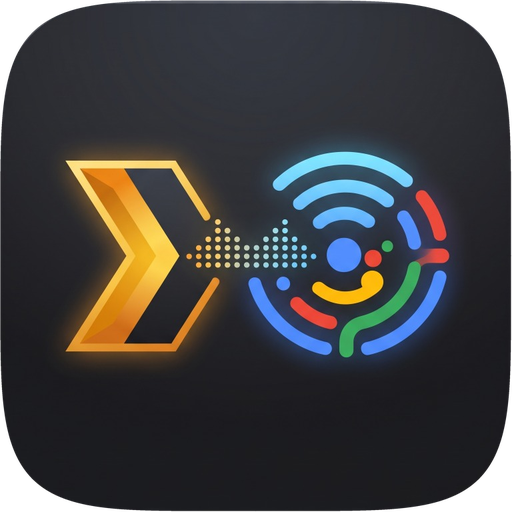

<p align="center">
  
</p>

<h1 align="center">Plex Cast Bridge</h1>

<p align="center">
  <strong>Personal Google Home Cloud-to-Cloud Integration, Gemini-Powered Smart DJ, and Continuous Plex Radio Streaming for Google Cast Speakers.</strong>
</p>

<p align="center">
  <a href="#features">Features</a> &bull;
  <a href="#architecture">Architecture</a> &bull;
  <a href="#repository-structure">Repository Structure</a> &bull;
  <a href="#quick-start-local-mac-emulator">Local Emulator</a> &bull;
  <a href="#google-home-setup--cloud-run-gateway">Google Home Setup</a> &bull;
  <a href="#production-deployment">Production Deploy</a> &bull;
  <a href="#monthly-cost-estimate">Cost Estimate</a>
</p>

---

## Features

- 🎵 **Plex Music Radio & Station Streaming:** Continuous "Pandora-style" radio mixes streamed directly from your personal Plex Media Server. Supports Plex Sonic Analysis stations and Gemini-curated sonic peer interleaving (~25% seed artist, ~75% sonic peers, with Track 1 always pinned to your requested artist).
- 🧠 **Gemini Smart DJ:** Powered by Google Gemini (`gemini-3.5-flash` with automatic fallback to `gemini-3.5-flash-lite` and `gemini-3.8-flash`). Interprets natural voice prompts into strict artist playback (`artist`), artist stations (`artist_radio`), albums (`album`), tracks (`track`), or mood/era mixes (`theme_mix`) without hallucinating artists outside your catalog.
- ☁️ **Google Home Cloud-to-Cloud Gateway (`gcp-cloud-run/`):** Lightweight FastAPI service (`cloud_gateway`) designed for GCP Cloud Run, implementing a personal OAuth 2.0 server and standard Google Smart Home traits (`AppSelector`, `Channel`, `InputSelector`, `TransportControl`, `Volume`, `OnOff`).
- 📨 **Asynchronous Pub/Sub Pipeline:** Decouples the public cloud webhook from your local home network using Google Cloud Pub/Sub, delivering voice commands to your local worker with sub-second latency and zero inbound port-forwarding.
- 🔊 **Google Cast Auto-Discovery & Volume Protection:** Discovers Google Home/Nest speakers via `pychromecast` with a native macOS `dns-sd` fallback for reliable multi-homed discovery. Startup volume safety clamps (default 20%) prevent audio blast surprises.
- 💻 **Built-in Mac Speaker Emulator:** Test the full Plex + Gemini voice-control pipeline locally on your Mac using native audio (`afplay`) without requiring physical Cast hardware.
- 🐳 **Production Ready (`deploy/`):** Includes multi-stage Dockerfiles, `docker-compose.yml` (`network_mode: host` for Proxmox LXC), and Linux systemd unit files.

---

## Architecture

```text
 ┌──────────────────────┐
 │  "Hey Google, play   │
 │   DJ Shadow on Plex" │
 └──────────┬───────────┘
            ▼
 ┌─────────────────────────────────────────────────────────┐
 │ Google Assistant / Google Home App                      │
 └──────────┬──────────────────────────────────────────────┘
            │ HTTPS POST /fulfillment (EXECUTE intent)
            ▼
 ┌─────────────────────────────────────────────────────────┐
 │ GCP Cloud Run: gcp-cloud-run (cloud_gateway)            │
 │ • Personal OAuth 2.0 Server (/oauth/authorize, /token)  │
 │ • Smart Home Traits & 111-Artist Synonyms Catalog       │
 └──────────┬──────────────────────────────────────────────┘
            │ Publish JSON Command
            ▼
 ┌─────────────────────────────────────────────────────────┐
 │ Google Cloud Pub/Sub (Topic: plex-commands)             │
 └──────────┬──────────────────────────────────────────────┘
            │ Pull (Streaming Pull Subscriber)
            ▼
 ┌─────────────────────────────────────────────────────────┐
 │ Local Bridge: plex_cast_bridge (Mac / Proxmox LXC)      │
 │                                                         │
 │  1. Interpret Prompt ──> Google Gemini 3.5 Flash        │
 │  2. Build Radio Queue ──> Plex Server (192.168.88.166)  │
 │  3. Cast Media Stream ──> Master Bedroom (192.168.88.x) │
 └─────────────────────────────────────────────────────────┘
```

---

## Repository Structure

```text
plex-cast-bridge/
├── pyproject.toml                   # Unified workspace dependencies & pytest config
├── catalog.json                     # Canonical 111-artist voice synonym catalog
├── assets/                          # Project icons & branding
├── src/
│   └── plex_cast_bridge/            # LOCAL SERVICE (Runs on Mac / Proxmox LXC)
│       ├── main.py                  # FastAPI entrypoint & Pub/Sub consumer lifecycle
│       ├── config.py                # Local settings (Plex, Gemini, Cast, Pub/Sub)
│       ├── ai_router.py             # Gemini Smart DJ intent router & sonic peer selector
│       ├── plex_service.py          # Plex catalog, radio queue weighting & Track 1 pinning
│       ├── cast_manager.py          # Chromecast mDNS discovery & persistent speaker queue
│       ├── local_speaker.py         # macOS afplay local speaker emulator
│       └── pubsub_worker.py         # Background GCP Pub/Sub streaming pull subscriber
├── gcp-cloud-run/                   # CLOUD SERVICE (Deployed to GCP Cloud Run)
│   ├── Dockerfile                   # Multi-stage Cloud Run container image
│   ├── deploy.sh                    # Automated Cloud Run + Pub/Sub + Artifact pruning
│   └── src/
│       └── cloud_gateway/           # Cloud Run FastAPI package
│           ├── main.py              # Cloud Run entrypoint (/oauth/*, /fulfillment)
│           ├── auth.py              # OAuth 2.0 & JWT signing/verification
│           ├── smart_home.py        # Google Home SYNC / QUERY / EXECUTE handlers
│           └── pubsub_publisher.py  # GCP Pub/Sub publisher
├── deploy/                          # LOCAL PRODUCTION DEPLOYMENT CONFIGS
│   ├── Dockerfile                   # Container image for local bridge worker
│   ├── docker-compose.yml           # Proxmox LXC / Linux host-network compose file
│   └── plex-cast-bridge.service     # Linux systemd unit file
├── scripts/                         # CLI UTILITIES & E2E HARNESSES
│   ├── sync_plex_catalog.py         # Extracts Plex artists/genres -> catalog.json
│   ├── emulate_speaker.py           # Interactive Mac speaker emulator CLI
│   ├── test_live_cast.py            # Direct LAN Chromecast verification script
│   ├── test_voice_fulfillment.py    # End-to-end Cloud Run -> Pub/Sub -> Cast test
│   └── generate_icons.py            # Superellipse alpha-mask icon processor
└── tests/                           # UNIFIED TEST SUITE (uv run pytest)
    ├── test_local_playback.py       # Local queue, Plex service, and transport tests
    └── test_cloud_gateway.py        # Cloud Run OAuth, Smart Home, and webhook tests
```

---

## Quick Start: Local Mac Emulator

You can test and enjoy the entire smart radio experience directly on your Mac before touching physical speakers:

```bash
# 1. Clone repository
git clone https://github.com/andrewtryder/plex-cast-bridge.git
cd plex-cast-bridge

# 2. Install dependencies with uv
uv sync

# 3. Configure environment
cp .env.example .env
# Edit .env with your PLEX_URL, PLEX_TOKEN, and GEMINI_API_KEY

# 4. Launch interactive Google Home speaker emulator
uv run python scripts/emulate_speaker.py
```

### Interactive Emulator Commands
```text
Google Home > play DJ Shadow
Google Home > play DJ Shadow only
Google Home > play some 90s trip hop
Google Home > pause
Google Home > resume
Google Home > next
Google Home > vol 25
Google Home > status
Google Home > stop
```

Audio streams directly out of your Mac's speakers using macOS native `/usr/bin/afplay`, automatically advancing to the next track in the station queue when the current track finishes.

---

## Google Home Setup & Cloud Run Gateway

The GCP Cloud Run service is located in [`gcp-cloud-run/`](gcp-cloud-run).

### 1. Extract & Sync Your Plex Library Catalog
Extract your artists and genres into voice-friendly phonetic synonyms at `./catalog.json`:
```bash
uv run python scripts/sync_plex_catalog.py
```

### 2. Deploy Gateway to GCP Cloud Run
```bash
cp gcp-cloud-run/.env.example gcp-cloud-run/.env
# Edit gcp-cloud-run/.env with your OAUTH_SIGNING_SECRET, ADMIN_PASSPHRASE, and GOOGLE_CLIENT_SECRET
./gcp-cloud-run/deploy.sh
```
This copies the latest `catalog.json`, deploys the container to Cloud Run, provisions the Pub/Sub topic `plex-commands` and subscription `plex-commands-local-worker`, and prunes old container images in Artifact Registry.

### 3. Google Home Developer Console Account Linking
1. Open the [Google Home Developer Console](https://console.home.google.com/projects).
2. Under **Cloud-to-cloud > Account Linking**:
   - **Client ID:** Set to `GOOGLE_CLIENT_ID` from `gcp-cloud-run/.env`
   - **Client Secret:** Set to `GOOGLE_CLIENT_SECRET` from `gcp-cloud-run/.env`
   - **Authorization URL:** `https://<YOUR-CLOUD-RUN-URL>/oauth/authorize`
   - **Token URL:** `https://<YOUR-CLOUD-RUN-URL>/oauth/token`
3. Under **Fulfillment URL**:
   - `https://<YOUR-CLOUD-RUN-URL>/fulfillment`
4. In your **Google Home App** on your phone:
   - Tap **Settings > Works with Google > [test] Plex Cast Bridge**.
   - Enter your `ADMIN_PASSPHRASE` on the login screen to link your account.

---

## Local Worker Configuration

Once your Google Home account is linked, run the local worker to receive commands from Pub/Sub and cast to your physical speakers:

```bash
# Set your environment variables in .env:
# DEFAULT_SPEAKER_NAME=Master Bedroom
# DEFAULT_CAST_VOLUME=0.20
# GCP_PROJECT_ID=plex-cast-bridge-home
# GCP_PUBSUB_SUBSCRIPTION_ID=plex-commands-local-worker
# ENABLE_PUBSUB_LISTENER=true

uv run uvicorn plex_cast_bridge.main:app --host 0.0.0.0 --port 8000
```

---

## Voice Commands

Once linked, speak directly to any Google Home speaker, Nest Hub, or Google Pixel:

| Action | Voice Command |
|---|---|
| **Artist Radio** | *"Hey Google, switch to DJ Shadow on Plex"* |
| **Artist Radio** | *"Hey Google, play Fugazi on Plex"* |
| **Theme / Genre Mix** | *"Hey Google, play 90s trip hop on Plex"* |
| **Next Track** | *"Hey Google, next track on Plex"* |
| **Pause Playback** | *"Hey Google, pause Plex"* |
| **Resume Playback** | *"Hey Google, resume Plex"* |
| **Volume Control** | *"Hey Google, set Plex volume to 20%"* |

---

## Production Deployment

### Option A: Proxmox LXC with Docker Compose

Host networking is required for Chromecast mDNS discovery on local LAN:

```bash
# 1. Place service account key at ./gcp-credentials.json
# 2. Launch container using deploy/docker-compose.yml
docker compose -f deploy/docker-compose.yml up -d --build
docker compose -f deploy/docker-compose.yml logs -f
```

### Option B: Linux Systemd Service

```bash
# Copy and enable the systemd service
sudo cp deploy/plex-cast-bridge.service /etc/systemd/system/
sudo systemctl daemon-reload
sudo systemctl enable --now plex-cast-bridge
sudo journalctl -u plex-cast-bridge -f
```

---

## Monthly Cost Estimate

Running `plex-cast-bridge` for personal household use (~20 voice commands/day) costs effectively **\$0.00 to \$0.06/month**:

| Service | Configuration | Free Tier Allowance | Est. Monthly Cost |
|---|---|---|---|
| **GCP Cloud Run** | `min-instances=0`, 256Mi, `cpu-throttling` | 2M requests / 180k vCPU-sec | **\$0.00** |
| **GCP Cloud Pub/Sub** | 1 topic, 1 streaming pull subscriber | First 10 GB / month free | **\$0.00** |
| **GCP Artifact Registry** | Pruned to latest 2 images (~180 MB) | First 500 MB free | **\$0.00** |
| **Gemini API** | `gemini-3.5-flash` (~1,100 tokens/call) | Free Tier (or ~\$0.06/mo Paid Tier) | **\$0.00 – \$0.06** |

---

## Validation & Testing Harness

- **Unified Unit Test Suite (Local + Cloud Gateway):**
  ```bash
  uv run pytest
  ```
- **Live Speaker Cast Test:**
  ```bash
  uv run python scripts/test_live_cast.py "Play some 90s trip hop like DJ Shadow" "Master Bedroom"
  ```
- **Cloud Run & Pub/Sub Fulfillment Test:**
  ```bash
  uv run python scripts/test_voice_fulfillment.py "Fugazi" "Master Bedroom"
  ```

---

## License

MIT License. Open source and designed for personal, self-hosted media setups.
