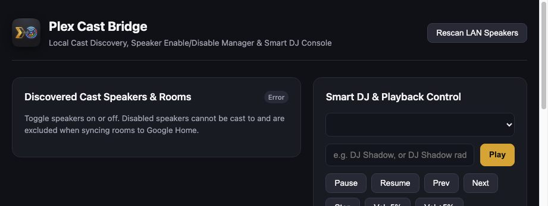

<p align="center">
  
</p>

<h1 align="center">Plex Cast Bridge</h1>

<p align="center">
  <strong>Self-hosted Plex music streaming for Google Home and Chromecast speakers, with Gemini-powered radio, voice control, and a Docker web dashboard.</strong>
</p>

<p align="center">
  <a href="https://github.com/andrewtryder/plex-cast-bridge/actions/workflows/ci.yml"></a>
  <a href="LICENSE"></a>
  <a href="https://github.com/andrewtryder/plex-cast-bridge/pkgs/container/plex-cast-bridge"></a>
</p>

<p align="center">
  <a href="#quick-start-docker">Docker Quick Start</a> &bull;
  <a href="#features">Features</a> &bull;
  <a href="#architecture">Architecture</a> &bull;
  <a href="docs/install-docker.md">Install Guide</a> &bull;
  <a href="docs/setup/SETUP_GUIDE.md">Google Home (advanced)</a> &bull;
  <a href="#license">License</a>
</p>

---

## Quick Start (Docker)

The easiest path is the prebuilt multi-arch image (`linux/amd64` + `linux/arm64`):

```bash
git clone https://github.com/andrewtryder/plex-cast-bridge.git
cd plex-cast-bridge
cp .env.example .env
# Set LOCAL_API_KEY=$(openssl rand -hex 32)
# Optional: PLEX_URL + PLEX_TOKEN for headless/env mode (or use Settings → Connect with Plex)
echo '{}' > gcp-credentials.json   # placeholder until Google Home voice is enabled

docker compose -f deploy/docker-compose.yml pull
docker compose -f deploy/docker-compose.yml up -d
```

Open `http://<host>:8000/?api_key=<LOCAL_API_KEY>`, use the Settings gear to **Connect with Plex** (or rely on env token), discover speakers, and play. Default/max Cast volumes can be edited under **Settings → Playback** (stored in `data/app_settings.json`; see [docs/setup/APP_SETTINGS.md](docs/setup/APP_SETTINGS.md)).

Full steps, preflight checks, and troubleshooting: **[docs/install-docker.md](docs/install-docker.md)**



Google Home / Cloud Run voice control is **optional** and documented separately: **[docs/setup/SETUP_GUIDE.md](docs/setup/SETUP_GUIDE.md)**.

---

## Features

- **Artist-first & station streaming:** Play an artist strictly from your library, or build Gemini-assisted radio / theme mixes.
- **Room-aware multi-speaker routing:** Virtual `Plex` devices per room (`plex-jukebox:<Room>`). Assign each device to its room in Google Home so voice follows the speaker that heard you.
- **Local web dashboard:** Discover Cast speakers, enable/disable rooms, and drive Smart DJ + transport from `http://localhost:8000`.
- **Gemini Smart DJ:** Natural-language intents (`artist`, `artist_radio`, `album`, `track`, `theme_mix`) constrained to your catalog.
- **Optional Google Home gateway (`gcp-cloud-run/`):** OAuth 2.0 account linking and Smart Home traits over Cloud Run + Pub/Sub (no inbound ports to your LAN).
- **Cast discovery & volume safety:** `pychromecast` with macOS `dns-sd` fallback; startup volume clamp (default 20%).
- **Mac speaker emulator:** Test without hardware via `afplay`.
- **Production packaging:** Multi-stage Dockerfiles, host-network Compose, systemd unit, Proxmox guide.

---

## Architecture

```text
 ┌──────────────────────┐
 │  "Hey Google, play   │
 │   <artist> on Plex"  │   (optional Google Home path)
 └──────────┬───────────┘
            ▼
 ┌─────────────────────────────────────────────────────────┐
 │ GCP Cloud Run (cloud_gateway)                           │
 │ OAuth + Smart Home SYNC / QUERY / EXECUTE / DISCONNECT  │
 └──────────┬──────────────────────────────────────────────┘
            │ Pub/Sub
            ▼
 ┌─────────────────────────────────────────────────────────┐
 │ Local bridge (Docker / Mac / Proxmox)                   │
 │ Dashboard · Gemini · Plex · Chromecast                  │
 └─────────────────────────────────────────────────────────┘
```

Dashboard-only installs skip Cloud Run and Pub/Sub entirely.

---

## Repository Structure

```text
plex-cast-bridge/
├── pyproject.toml
├── catalog.json                     # Sample catalog (replace via sync_plex_catalog.py)
├── LICENSE
├── assets/                          # Icons (incl. 144×144 Google Home upload)
├── src/plex_cast_bridge/            # Local bridge (FastAPI + Cast + Pub/Sub worker)
├── gcp-cloud-run/                   # Optional Cloud Run OAuth + fulfillment
├── deploy/                          # Dockerfile, compose, systemd
├── docs/
│   ├── install-docker.md            # Beginner Docker path
│   ├── proxmox-deployment.md
│   └── setup/SETUP_GUIDE.md         # Advanced Google Home path
├── scripts/                         # sync, preflight, emulator, e2e harnesses
└── tests/
```

---

## Local Mac Emulator

```bash
uv sync
cp .env.example .env
# Set LOCAL_API_KEY (or ALLOW_UNAUTHENTICATED_LOCAL_API=true); optional PLEX_URL/PLEX_TOKEN
uv run python scripts/preflight.py --skip-plex   # or full check without --skip-plex
uv run python scripts/emulate_speaker.py
```

---

## Google Home (advanced)

See the step-by-step guide: [docs/setup/SETUP_GUIDE.md](docs/setup/SETUP_GUIDE.md).

Summary:

1. Sync catalog → deploy `gcp-cloud-run/`
2. Create a Cloud-to-cloud integration in the **Google Home Developer Console**
3. Create a Pub/Sub **subscriber** service account JSON for the local worker
4. Link the **`[test]`** integration in the Google Home app

This repo targets personal / test integrations. Public Google certification is out of scope unless you pursue it separately.

---

## Production Deployment

- **Docker / Proxmox:** [docs/install-docker.md](docs/install-docker.md) and [docs/proxmox-deployment.md](docs/proxmox-deployment.md)
- **Image:** `ghcr.io/andrewtryder/plex-cast-bridge:latest` (and version tags from GitHub Releases). The package must be marked **Public** in GHCR package settings for anonymous pulls.
- **Systemd:** `deploy/plex-cast-bridge.service`

---

## Monthly Cost Estimate

Personal use (~20 voice commands/day) is typically **\$0.00–\$0.06/month** within GCP/Gemini free tiers (Cloud Run min-instances=0, Pub/Sub, pruned Artifact Registry).

---

## Testing

```bash
uv run pytest
uv run python scripts/preflight.py
```

---

## License

[MIT](LICENSE). Open source for personal, self-hosted media setups.
