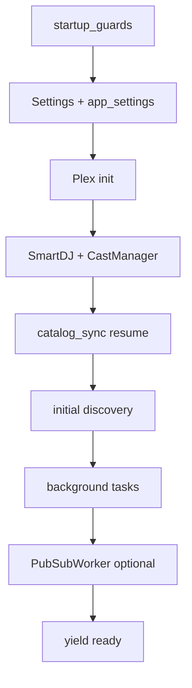

# Phase 8 — Application lifespan contracts

Startup and shutdown order for `plex_cast_bridge.main.lifespan` (synthetic tests must not
contact Plex, Cast, Google Cloud, or live Pub/Sub).

## Startup sequence

| Step | Operation | Can raise / spawn tasks |
|------|-----------|-------------------------|
| 1 | `ensure_persistent_data_mount(DATA_DIR)` | **raise** `RuntimeError` |
| 2 | `require_existing_configuration(DATA_DIR)` | **raise** `RuntimeError` |
| 3 | `ensure_pubsub_credentials(...)` | **raise** `RuntimeError` |
| 4 | `music_index_scan.recover_interrupted` (if DB exists) | threadpool; may log |
| 5 | `load_app_settings` + `apply_to_settings` | no |
| 6 | `app.state.settings`, `plex_auth` | no |
| 7 | Plex `init_plex_service` | **catch** → `plex=None` |
| 8 | `SmartDJ`, `CastManager` | threadpool in Plex path only |
| 9 | `catalog_sync.configure_gateway` / `resume_pending_push` | warn on configure failure |
| 10 | Initial speaker `discover` + persist (unless `PCB_DISABLE_BACKGROUND_DISCOVERY`) | warn on failure |
| 11 | Background discovery task (if interval > 0) | **task** |
| 12 | Music index scheduler | **task** |
| 13 | Google Home reconciliation | **task** |
| 14 | `PubSubWorker` (if enabled) | **raise** → cancels steps 11–13 |
| 15 | `yield` (application ready) | — |

## Shutdown sequence

Matches pre-Phase-8 `main.py` ordering (`shutdown_application`).

| Step | Operation | On failure |
|------|-----------|------------|
| 1 | Cancel **music-index** scheduler; await | Log; continue |
| 2 | `music_index_scan.cancel` (if DB exists) | Log; continue |
| 3 | `catalog_sync.stop_pending_push` | Log; continue |
| 4 | Cancel **reconcile** task; await | Log; continue |
| 5 | Cancel **discovery** task; await | Log; continue |
| 6 | `PubSubWorker.close` (once) | Log; continue |
| 7 | `CastManager.close` | Log; continue |

## Startup abort (before `yield`)

When Pub/Sub worker construction fails after background tasks start:

1. `stop_pending_push`
2. Cancel music-index → reconcile → discovery (await each)
3. `CastManager.close` via threadpool
4. Re-raise the startup exception

## Task ownership

| Task | Owner module | Interval / backoff |
|------|----------------|------------------|
| Speaker discovery | `startup_lifecycle.schedule_speaker_discovery` | `max(interval, 60)` s; overlap skip via `asyncio.Lock` |
| Music index | `startup_lifecycle.schedule_music_index` | 60 s poll |
| Google Home reconcile | `startup_lifecycle.schedule_google_home_reconcile` | `catalog_reconcile_interval_sec`; exponential backoff on failure (max 300 s) |

## Dependency map (startup)

Pub/Sub construction failure after background tasks start triggers `cancel_background_tasks`
before the exception propagates (no orphaned reconcile / index loops).
