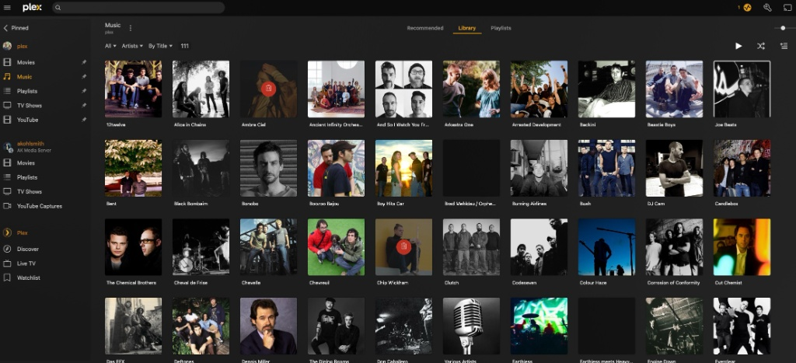
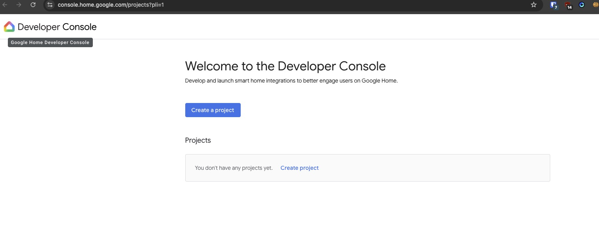
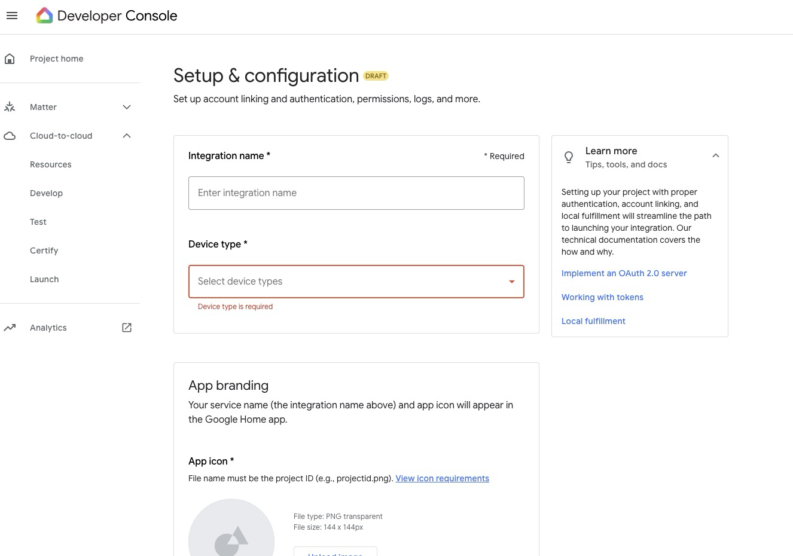
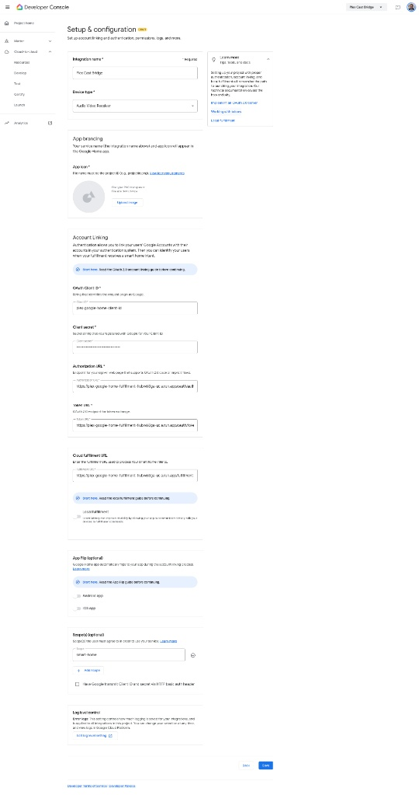
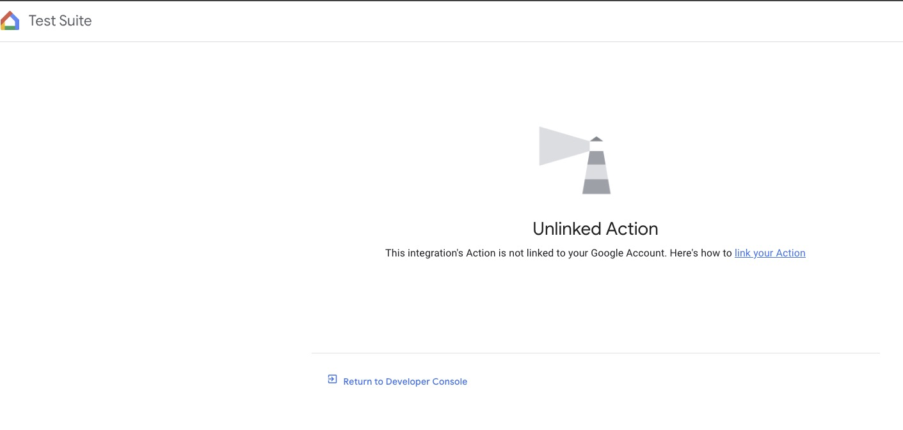

# Google Home voice setup (advanced)

This guide adds **Hey Google** control on top of a working local bridge. Complete [Docker install](../install-docker.md) (or the Mac emulator) first so Plex + Cast playback already works.

**Preferred path:** use **Settings → Connections → Google Home** in the dashboard wizard. This guide is the long-form reference. For an existing installation, preserve its cloud resources and credentials; do not run provisioning scripts unless you intend to create or modify resources.

Speaker/library changes sync to Cloud Run via `PUT /internal/catalog` (no redeploy). Use **Refresh & Sync Google Home** after linking. Room assignment for virtual devices still happens in the Google Home app.

**Cast speakers** are LAN destinations. **Virtual Plex devices** are what Google Home lists (one per destination you mark **Show in Google Home**). Stable device IDs survive renames and IP changes; newly discovered speakers stay hidden until you opt them in. This does not expose which Nest mic heard a command and is not a native Assistant music provider.

Personal / household use is supported via a **test** Cloud-to-cloud integration. Public Google Home certification is a separate process and is **not** required to use this project at home.

---

## 1. Architecture

```text
[Google Assistant / Nest / Home app]
        │  OAuth link + SYNC / QUERY / EXECUTE / DISCONNECT
        ▼
[Cloud Run: cloud_gateway]
        │  Pub/Sub publish
        ▼
[Pub/Sub topic: plex-commands]
        │  Streaming pull (no inbound ports)
        ▼
[Local plex-cast-bridge] → Plex + Cast speakers
```

---

## 2. Local Plex library

Ensure a Music library section exists and note your `X-Plex-Token`. Sync artists into the catalog the cloud gateway will serve:

```bash
uv run python scripts/sync_plex_catalog.py
```



---

## 3. Google Cloud provisioning (first-time installation only)

Do not follow this section to upgrade or recover an existing installation. Existing installations keep their Google Home Developer Console project, Cloud Run service, service account, Firestore state, OAuth values, catalog bucket, and virtual-device IDs. Use the image-only process in [persistent state and upgrades](../persistent-state.md). If the dashboard finds saved gateway configuration, it disables this provisioning flow; a missing wizard file does not mean the account is unlinked.

1. Create a GCP project and enable billing.
2. Enable **Cloud Run**, **Cloud Pub/Sub**, **Cloud Build**, and **HomeGraph** APIs.
3. Deploy the gateway (creates the Pub/Sub topic/subscription and Cloud Run service):

```bash
cp gcp-cloud-run/.env.example gcp-cloud-run/.env
# Set OAUTH_SIGNING_SECRET, ADMIN_PASSPHRASE, GOOGLE_CLIENT_ID, GOOGLE_CLIENT_SECRET
./gcp-cloud-run/deploy.sh <project> us-central1 plex-commands plex-commands-local-worker plex-google-home-fulfillment plex-fulfillment-sa --first-install-confirmed
```

Note the Cloud Run URL, for example `https://plex-google-home-fulfillment-….run.app`.

---

## 4. Create the Cloud-to-cloud integration

**Use the [Google Home Developer Console](https://console.home.google.com/projects)** for new projects. The legacy Actions on Google console is deprecated / view-only for new work after the December 2024 migration.

1. Open [console.home.google.com/projects](https://console.home.google.com/projects) and create or select your project.
2. Add a **Cloud-to-cloud** integration.
3. Under **Develop → Setup & configuration**:
   - **Integration name:** `Plex Cast Bridge`
   - **Device type:** Speaker (`action.devices.types.SPEAKER`)
   - **App icon:** Upload a **144×144** PNG with a round presentation (use [`assets/icon-144.png`](../../assets/icon-144.png), generated from [`assets/icon.png`](../../assets/icon.png))





### Account linking & fulfillment URLs

| Field | Value |
|---|---|
| OAuth Client ID | Your `GOOGLE_CLIENT_ID` |
| Client secret | Your `GOOGLE_CLIENT_SECRET` |
| Authorization URL | `https://<CLOUD_RUN_URL>/oauth/authorize` |
| Token URL | `https://<CLOUD_RUN_URL>/oauth/token` |
| Cloud fulfillment URL | `https://<CLOUD_RUN_URL>/fulfillment` |
| Scope(s) | `smart-home` |



> **Historical note:** Older screenshots under `screenshots/04`–`07` show the Actions Console. Prefer the Home Developer Console for anything new. If a multi-login redirect fails, use a clean browser profile signed into the same Google account as the GCP project.

---

## 5. Pub/Sub subscriber credentials (local worker)

`deploy.sh` creates a **publisher** service account for Cloud Run. The **local bridge** needs a separate subscriber key.

1. In GCP IAM, create a service account, e.g. `plex-local-subscriber@<PROJECT_ID>.iam.gserviceaccount.com`.
2. Grant it **Pub/Sub Subscriber** on the subscription `plex-commands-local-worker` (or project-level `roles/pubsub.subscriber` if you accept broader scope).
3. Create a JSON key and save it **outside git** as `gcp-credentials.json` next to your compose `.env`.
4. Restrict filesystem permissions:

```bash
chmod 600 gcp-credentials.json
# On Linux Docker host with the compose appuser GID:
# sudo chown root:10001 gcp-credentials.json && sudo chmod 640 gcp-credentials.json
```

5. Enable the listener in `.env`:

```bash
GCP_PROJECT_ID=<your-project>
GCP_PUBSUB_SUBSCRIPTION_ID=plex-commands-local-worker
ENABLE_PUBSUB_LISTENER=true
GOOGLE_APPLICATION_CREDENTIALS=/app/gcp-credentials.json   # already set in compose
```

6. Re-run preflight and restart the container:

```bash
uv run python scripts/preflight.py
docker compose -f deploy/docker-compose.yml up -d
```

Never commit `gcp-credentials.json`.

---

## 6. Test integration vs public launch

| Mode | What you do | Audience |
|---|---|---|
| **Personal test** | Enable testing / draft in the Home Developer Console; link `[test] Plex Cast Bridge` in the Google Home app | Your Google account / household |
| **Public launch** | Google certification, additional review, production policies | Anyone — **out of scope** for this repo’s default docs |

Account linking UX in the Google Home app continues to evolve (including deep-link / in-app linking changes with an **October 30, 2026** deadline for affected integrations). Prefer the current in-app **Works with Google** flow documented by Google:

- [Cloud-to-cloud account linking](https://developers.home.google.com/cloud-to-cloud/primer/account-linking)
- [Google Home Developer Console](https://developers.home.google.com/console/get-started)

---

## 7. Link in the Google Home app

1. Open the **Google Home** app (same Google account as the developer project).
2. **Devices → + Add → Works with Google**.
3. Select **`[test] Plex Cast Bridge`**.
4. On the Google Home linking page, note the six-digit code. In the Plex Cast Bridge dashboard, open **Settings → Connections**, check that the code matches, and approve. Return to Google Home to finish. No passphrase entry is needed.
5. In the dashboard, enable **Show in Google Home** for each Cast destination you want exposed, then **Refresh & Sync Google Home**.
6. In the Google Home app, assign each virtual device (for example **Kitchen Plex**) to the room you prefer. `room_hint` from the bridge is only a suggestion.

### Managing speakers after setup (no wizard restart)

| Action | What to do |
| --- | --- |
| New Nest / Cast device | **Refresh speakers** → optionally enable playback → enable **Show in Google Home** → **Refresh & Sync Google Home** → assign room in the Home app |
| Rename a speaker | Refresh speakers (identity preserved via Cast UUID / stored Google Home id) → sync if the virtual name changed |
| Hide from Google Home | Turn off **Show in Google Home** → sync |
| Forget destination | **Forget** confirms removal of the virtual Plex device on next sync — Nest hardware stays in Google Home |
| Temporary offline | Settings are retained; no automatic delete; HomeGraph sync is not requested for offline-only scans |

Upgrade (Proxmox / Docker): pull the new image, keep `data/` (catalog, JWT, cloud credentials). On first start the bridge migrates speaker records idempotently and preserves existing `plex-jukebox:…` Google Home IDs when they can be matched. Redeploy Cloud Run only when the gateway image changes — ordinary speaker edits do not require a new GCP project or key rotation.

If the web Test Suite shows **Unlinked Action**, link on the phone first:



---

## 8. Verify voice

Pause and next have been observed on the existing deployment. Test controls against your own named virtual device or assigned room:

- “Hey Google, next track on Bedroom Plex”
- “Hey Google, pause Kitchen Plex”

Artist-search phrases such as “play an artist on Kitchen Plex” have not been verified as a supported Assistant music-provider flow. Use the dashboard to choose music.

Unlinking in the Google Home app sends `action.devices.DISCONNECT` to the gateway; the bridge acknowledges unlink so Home Graph clears the association. Catalog changes stay local until you relink and sync again.
