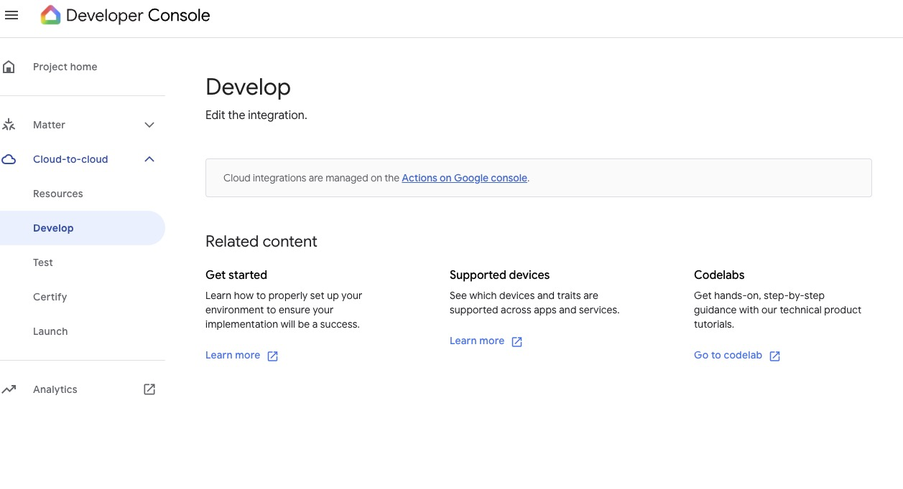
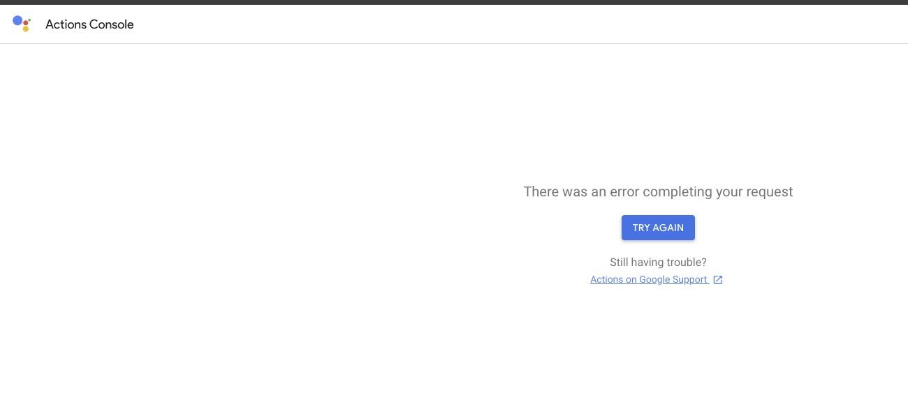
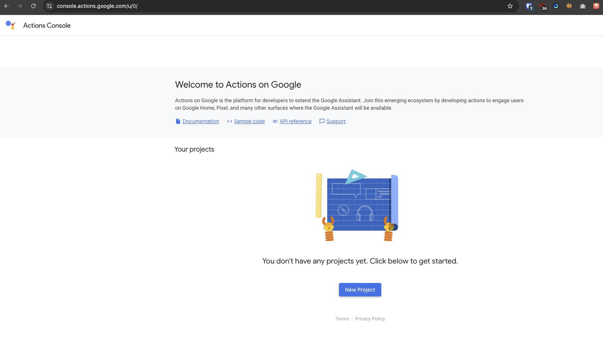
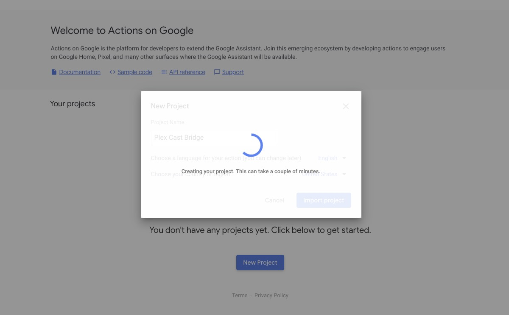
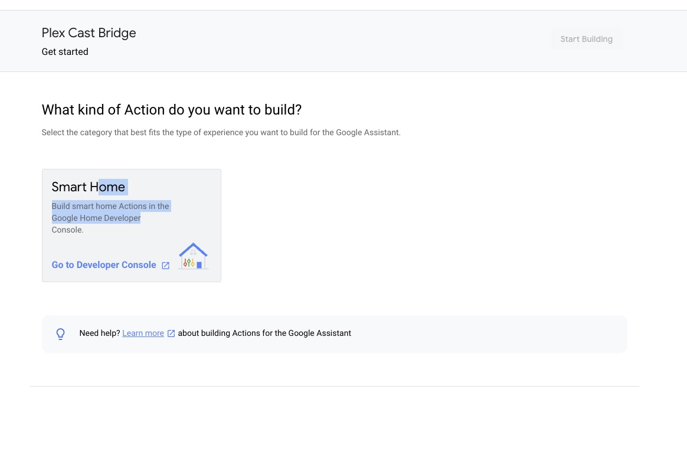
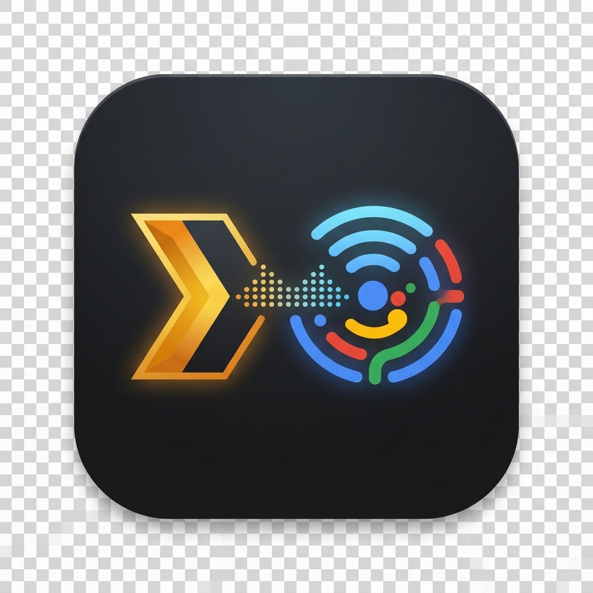

# Google Cloud & Google Home Developer Console Setup Guide

This guide walks through provisioning the Google Cloud infrastructure, configuring the Actions on Google / Google Home Developer Console, and linking **Plex Cast Bridge** to your Google Home app for local Plex streaming.

---

## 1. Architecture Overview

```text
[Google Assistant / Nest Speaker / Mobile App]
                    │
                    │ 1. OAuth2 Account Linking (/oauth/authorize, /oauth/token)
                    │ 2. Smart Home Intents: SYNC, QUERY, EXECUTE (/fulfillment)
                    │ 3. Direct Query Webhook (/webhook/query)
                    ▼
[GCP Cloud Run: gcp-cloud-run (cloud_gateway)]
                    │
                    │ Publishes command payload to GCP Pub/Sub Topic
                    ▼
[GCP Pub/Sub Topic: plex-commands]
                    │
                    │ Outbound StreamingPull (No inbound firewall ports required)
                    ▼
[Local Home Server: plex-cast-bridge]
     ├── Local Admin & Speaker Management Web UI (http://localhost:8000)
     ├── Google Cloud Pub/Sub Worker (pubsub_worker.py)
     ├── Google Gemini Flash Intent Parser (ai_router.py)
     ├── Local Plex Media Server (plex_service.py)
     └── Stateful Cast Controller (cast_manager.py)
```

---

## 2. Local Plex Library Preparation

Ensure your Plex Media Server has a dedicated Music library section (e.g., `Music`) accessible on your local subnet (`http://<PLEX_LAN_IP>:32400`) and retrieve your `X-Plex-Token`.


---

## 3. Google Cloud Platform (GCP) Provisioning

1. Create a GCP project (e.g., `plex-cast-bridge-home`) and enable billing.
2. Enable the **Cloud Run API**, **Cloud Pub/Sub API**, **Cloud Build API**, and **HomeGraph API**.
3. Provision the Pub/Sub topic and subscription:
   - **Topic:** `projects/<PROJECT_ID>/topics/plex-commands`
   - **Subscription:** `projects/<PROJECT_ID>/subscriptions/plex-commands-local-worker`
4. Sync your local Plex catalog and discovered Cast speakers into `catalog.json`, then deploy `gcp-cloud-run` to Cloud Run (`us-central1`) using `./gcp-cloud-run/deploy.sh`:
   ```bash
   uv run python scripts/sync_plex_catalog.py
   ./gcp-cloud-run/deploy.sh
   ```
5. Note your live Cloud Run URL (e.g., `https://plex-google-home-fulfillment-<hash>-uc.a.run.app`).

---

## 4. Initializing the Project in Actions on Google & Developer Console

Because Google Home Cloud-to-Cloud integrations rely on an underlying Actions on Google project, initialize the project in the Actions Console first if it does not yet appear in the Google Home Developer Console.

### Step 4.1: Open the Google Home Developer Console
Navigate to `https://console.home.google.com/projects`. If no projects are listed yet, click **Create a project** or initialize via the Actions Console.


### Step 4.2: Navigating Cloud-to-Cloud Integration
Under **Cloud-to-cloud > Develop**, Google links out to the **Actions on Google console**.



> **Troubleshooting Multi-Login Redirect Errors:** If clicking the link produces *"There was an error completing your request"*, open `https://console.actions.google.com/` directly in a dedicated browser profile or Incognito window logged into your primary GCP account.



### Step 4.3: Create / Import Project in Actions Console
1. Go directly to `https://console.actions.google.com/`.
2. Click **New Project**.



3. Select or enter your GCP Project (`Plex Cast Bridge` / `plex-cast-bridge-home`) and click **Import project**.



4. Select **Smart Home** as the Action category and click **Go to Developer Console** / **Start Building**.



---

## 5. Configuring Cloud Fulfillment & OAuth 2.0 Account Linking

Inside the Google Home Developer Console under **Cloud-to-cloud > Develop** (**Setup & configuration**):


### Step 5.1: Basic Integration Info & Branding
- **Integration name:** `Plex Cast Bridge`
- **Device type:** `Set-top box` or `Audio Video Receiver`
- **App icon:** Upload a 144x144px PNG icon (`assets/icon-128.png` or `10-plex-cast-bridge-app-icon.jpg`).



### Step 5.2: Account Linking & Cloud Fulfillment URL
Fill in the OAuth 2.0 and Fulfillment fields pointing to your Cloud Run service:
- **OAuth Client ID:** `plex-google-home-client-id` (or your configured `GOOGLE_CLIENT_ID`)
- **Client secret:** `<YOUR_GOOGLE_CLIENT_SECRET>`
- **Authorization URL:** `https://<YOUR_CLOUD_RUN_URL>/oauth/authorize`
- **Token URL:** `https://<YOUR_CLOUD_RUN_URL>/oauth/token`
- **Cloud fulfillment URL:** `https://<YOUR_CLOUD_RUN_URL>/fulfillment`
- **Scope(s):** `smart-home`

Click **Save** at the bottom of the page.


---

## 6. Enabling Draft Testing & Linking in the Google Home Mobile App

### Why the Web Test Suite Shows "Unlinked Action" First
If you click **Test** in the web console before linking your account on your mobile phone, the Test Suite will display **Unlinked Action**:


### Linking on iOS / Android
1. Open the **Google Home** app on your phone (logged into the same Google account).
2. Tap **Devices** -> **+ Add** -> **Works with Google**.
3. Select **`[test] Plex Cast Bridge`** at the top of the list.
4. When redirected to your Cloud Run `/oauth/authorize` login page, enter your configured `ADMIN_PASSPHRASE` and authorize.
5. Assign the virtual **Plex** device (or per-room virtual devices like **Master Bedroom Plex**, **Kitchen Plex**) to the corresponding rooms in your home so Google Assistant automatically routes commands to whichever room speaker heard you.
